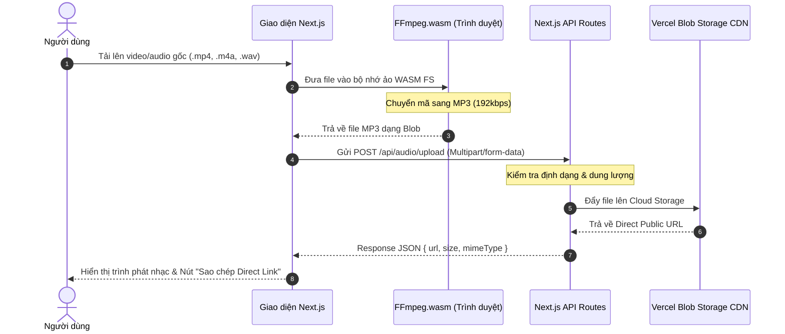

# ⚡ DirectFile — Hệ Thống Chuyển Đổi & Phân Phối URL Đa Phương Tiện Trực Tiếp

[](https://nextjs.org/)
[](https://www.typescriptlang.org/)
[](https://ffmpegwasm.netlify.app/)
[](https://vercel.com/docs/storage/vercel-blob)
[](https://vitest.dev/)

**DirectFile** là ứng dụng web hiệu năng cao cho phép chuyển đổi định dạng âm thanh/video trực tiếp trên trình duyệt (Client-side WebAssembly) và lưu trữ phân phối URL đa phương tiện (MP3 & Image) thông qua dịch vụ lưu trữ đám mây CDN tốc độ cao.

---

## 🎯 Bài Toán Nghiệp Vụ & Giải Pháp (Business Problem & Technical Solution)

| Thách thức hệ thống thông thường | Giải pháp kỹ thuật tối ưu trong DirectFile |
|---|---|
| Server bị quá tải CPU khi nhiều người dùng cùng convert video/audio dung lượng lớn | **Client-side Transcoding:** Chạy `ffmpeg.wasm` trực tiếp trên Thread của trình duyệt người dùng, Server không tốn tài nguyên chuyển mã |
| Các trang chia sẻ file thường chuyển hướng qua nhiều trang trung gian chứa quảng cáo | Cung cấp **Direct URL** ổn định truy cập trực tiếp đến file gốc (MP3, PNG, JPG) với CDN phân tán toàn cầu |
| Độ trễ khi upload toàn bộ video nặng lên server | Chỉ upload file MP3 đã nén gọn sau khi chuyển đổi xong ngay trên Client |
| Rủi ro lỗi bộ nhớ trình duyệt | Xử lý streaming qua `Blob` và thu hồi bộ nhớ (`URL.revokeObjectURL`) tránh memory leak |

---

## 🏗️ Kiến Trúc Luồng Xử Lý (Architecture & Data Flow)



---

## ✨ Tính Năng Nổi Bật

- 🎙️ **Chuyển đổi MP3 trong Browser:** Hỗ trợ mọi định dạng đầu vào phổ biến (.mp4, .mov, .avi, .m4a, .aac, .wav) chuyển sang chuẩn `.mp3` mà không cần upload file gốc lên máy chủ.
- 🖼️ **Xử lý Ảnh Trực Tiếp:** Tải ảnh nguyên bản lên Blob CDN, tự động tạo URL trực tiếp phục vụ nhúng website, banner hoặc diễn đàn.
- 🎧 **Trình Xem Trước Tức Thì (Media Preview):** Tích hợp trình phát Audio Player và Image Viewer ngay tại giao diện với thanh tiến trình tải chi tiết.
- ⚡ **Bố Cục Chia Đôi Tối Ưu (Split Layout):** Giao diện chia rõ 2 phân hệ độc lập: Khối xử lý Âm thanh và Khối xử lý Hình ảnh.

---

## 📡 Đặc Tả API (API Endpoints)

### 1. Upload File Âm Thanh (Audio Upload)
- **Endpoint:** `POST /api/audio/upload`
- **Content-Type:** `multipart/form-data`
- **Body:** `file` (File MP3 dạng nhị phân)
- **Response Success (200 OK):**
  ```json
  {
    "url": "https://[store-id].public.blob.vercel-storage.com/audio-uuid.mp3",
    "pathname": "audio-uuid.mp3",
    "contentType": "audio/mpeg"
  }
  ```
- **Response Error (503 Service Unavailable):**
  ```json
  {
    "error": "Blob storage chưa được cấu hình. Vui lòng kiểm tra BLOB_READ_WRITE_TOKEN."
  }
  ```

### 2. Upload File Hình Ảnh (Image Upload)
- **Endpoint:** `POST /api/image/upload`
- **Content-Type:** `multipart/form-data`
- **Body:** `file` (File ảnh PNG/JPEG/WEBP)
- **Response Success (200 OK):**
  ```json
  {
    "url": "https://[store-id].public.blob.vercel-storage.com/image-uuid.png",
    "pathname": "image-uuid.png",
    "contentType": "image/png"
  }
  ```

---

## 🚀 Hướng Dẫn Cài Đặt & Phát Triển (Local Setup)

### Yêu cầu tiên quyết:
- **Node.js** >= 18.17.0
- Tài khoản **Vercel** có kết nối Blob Storage (hoặc chạy mock test)

### Các bước thực hiện:
```bash
# 1. Clone repository
git clone https://github.com/dungnguyen0537/DirectFile.git
cd DirectFile

# 2. Cài đặt packages
npm install

# 3. Cấu hình biến môi trường
cp .env.example .env.local
# Điền token Vercel Blob vào:
# BLOB_READ_WRITE_TOKEN="vercel_blob_rw_..."

# 4. Chạy chế độ Development
npm run dev
```
Truy cập ứng dụng tại: `http://localhost:3000`

### Kiểm thử tự động (Unit Test):
```bash
npm test -- --run
```

---

## 📊 Yêu Cầu Phi Chức Năng (NFR)
- **Bảo mật:** Giới hạn kích thước file tải lên, lọc chặt chẽ `mime-type` nhằm chống tải lên các tệp thực thi mã độc.
- **Tối ưu mạng (Bandwidth):** Nhờ cơ chế chuyển mã tại máy khách (WASM), băng thông máy chủ giảm tới **80%** so với mô hình xử lý tập trung truyền thống.
- **Cross-Origin Isolation:** Cấu hình đúng `COOP` và `COEP` headers để kích hoạt đa luồng `SharedArrayBuffer` cho FFmpeg.wasm hoạt động mượt mà.

---

## 👤 Tác Giả
- **Nguyễn Văn Dũng** (HaUI - Information Systems)
- **GitHub:** [@dungnguyen0537](https://github.com/dungnguyen0537)
- **Email:** dungnguyen120737@gmail.com
